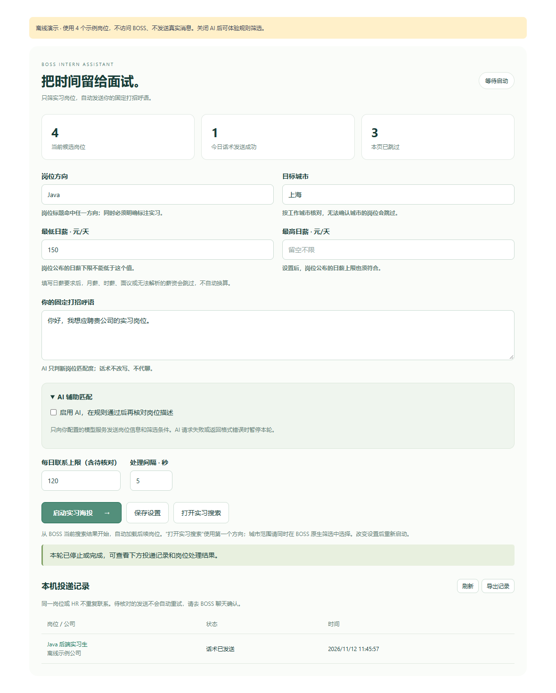

# 实习海投助手

基于 [Ocyss/boss-helper](https://github.com/Ocyss/boss-helper) 的 BOSS 直聘浏览器插件派生版，专注实习筛选与固定话术自动打招呼。

**状态：0.1.0，本地构建与离线流程验证版本。尚未使用真实 BOSS 账号验证当前网站的完整投递流程。** BOSS 页面或接口变动可能影响兼容性。



## 第一版功能

- 在 BOSS 网页里填写岗位方向、城市、日薪范围、固定打招呼语，保存后启动。
- 从当前 BOSS 搜索结果读取岗位，继续加载后续结果；按实习、方向、城市、日薪筛选，通过后自动打招呼。
- AI 可辅助分析岗位描述；只发筛选条件、补充要求和岗位信息，不生成或改写招呼语。
- 固定话术原样发送，不替换模板变量，不自动回复 HR，不自动发送附件。
- 同一 BOSS 账号下的岗位和 HR 持久去重。通过数据库事务阻止两个标签页同时重复联系同一 HR。
- 发送前先记录预留状态；网络错误、AI 返回无效、页面异常时暂停。发送结果不明确时不自动重试。
- 本机联系记录、导出记录、每日联系上限、处理间隔和停止按钮。
- 不读取上游远程公告。密钥和配置使用本地扩展存储，不随源码提交。

## 安装

适用于 Chrome / Edge，使用 Manifest V3。

1. 解压构建好的插件 ZIP。
2. 打开 `chrome://extensions` 或 `edge://extensions`，开启开发者模式。
3. 选择“加载已解压的扩展程序”，选中**直接包含 manifest.json 的文件夹**。
4. 登录 BOSS 直聘，打开职位搜索页，刷新后会出现“实习海投”面板。
5. 填写自己的筛选条件和固定话术。需要 AI 时，进入模型设置，填写自己选择的服务地址、密钥、模型名称并保存，然后回到 BOSS 页面选择模型。
6. 先在 BOSS 原生搜索中选择目标城市和岗位；再点击“启动实习海投”。通过筛选会直接建立沟通并发送固定话术。

“打开实习搜索”使用填写的**第一个方向**加“实习”作为搜索词，并保留当前 URL 中的城市代码。它不会自动轮询所有方向或切换城市。插件会再按用户填写的所有方向和城市进行核对。

若没有配置 AI，可取消“启用 AI”，仅使用明确规则。AI 配置错误不会自动降级继续发送。

## 筛选语义

| 条件 | 行为 |
| --- | --- |
| 仅实习 | 岗位标题含“实习”/英文 intern，或类型标签明确为实习；“有实习经历优先”的普通岗位不算实习。没有充分证据就跳过。 |
| 岗位方向 | 多个词用逗号或换行分隔，岗位标题/岗位方向命中任一关键词即可；AI 只在硬条件通过后再分析。 |
| 城市 | 工作城市准确匹配，允许“上海”与“上海市”；城市字段缺失时只尝试工作地址开头，不在描述全文里猜城市。 |
| 最低日薪 | 岗位公布的日薪下限必须不低于设置值。 |
| 最高日薪 | 可留空；设置时岗位公布的日薪上限也必须不高于设置值。 |
| 薪资无法解析 | 设置了日薪要求时，月薪、时薪、面议和混合单位全部跳过，不自动换算；两端均留空则不限制薪资。 |
| 已联系 / 结果不明确 | 自动跳过，不重发；到 BOSS 聊天记录核对并手动处理。 |

每日联系上限包括本机已预留、已建立沟通、成功与待核对记录，不是平台额度承诺。软件不会绕过验证码、登录验证、频率或联系数量限制。

## 离线演示

在已加载插件的详情页复制扩展 ID，打开 `chrome-extension://扩展ID/demo.html`。演示只使用示例岗位，不访问 BOSS、不发送真实消息；关闭 AI 后可以体验筛选和去重。示例投递记录与真实账号分开保存，填写的设置仍保存在本机。

## 开发

Node.js 24.17+，pnpm 11.25。仓库内已包含所需日志组件的源码，不需要额外初始化 Git 子模块。

```sh
pnpm install --frozen-lockfile --ignore-scripts
pnpm exec wxt prepare
pnpm test
pnpm check
pnpm build:chrome
```

产物位于 `.output/chrome-mv3/`；`pnpm zip:chrome` 可生成插件 ZIP。Edge 可直接加载 Chrome 的 MV3 产物。调试使用 `pnpm dev`。

离线浏览器检查：`node scripts/verify-internship-ui.mjs`。默认使用 Windows Edge 的独立测试配置，不使用个人浏览器账号；其他系统通过 `INTERN_TEST_BROWSER` 指定支持加载扩展的 Chromium 浏览器路径。测试会阻止网页 HTTP 请求，并生成上方截图。

## 结构

- `src/internship/policy.ts`：独立可测试的实习、城市、方向、日薪与 AI 结果校验。
- `src/internship/delivery.ts`：筛选 → AI → 去重预留 → 建立沟通 → 固定话术 → 记录结果。
- `src/internship/history.ts`：扩展后台的 IndexedDB 事务、去重和每日联系上限。
- `src/components/InternshipPanel.vue`：启动时配置和运行界面。
- `src/entrypoints/boss/`：沿用并修改上游的网站适配器。
- `tests/`：规则、发送故障、停止和并发去重测试。
- `.github/workflows/main.yml`：测试、类型检查、构建并上传构建产物，不自动发布商店。

## 来源、范围与后续迭代

本项目不是 BOSS 官方产品。派生自 `Ocyss/boss-helper` 提交 [`7526ebab572a98823904e3cfb9f979a715fe58f6`](https://github.com/Ocyss/boss-helper/tree/7526ebab572a98823904e3cfb9f979a715fe58f6)，保留 MIT 许可证和版权声明；上游原始说明存于 `docs/UPSTREAM_README.md`。依赖来源见 [THIRD_PARTY_NOTICES.md](THIRD_PARTY_NOTICES.md)。

目前保留了部分上游代码供后续迭代，但实习海投入口只使用本页列出的能力。AI 招呼语、自动代聊、附件投递、飞书同步不在本版运行界面提供。

后续可基于真实兼容性反馈增加岗位搜索队列、多城市轮询、拒绝原因统计和更完整的页面适配测试。当前没有把这些未实现功能计入第一版。

实际发送依赖登录状态、BOSS 页面结构、接口和消息回执。离线验证不能替代真实网站验证；自动操作可能触发平台风控，应遵守平台规则。遇到待核对状态先查看真实聊天记录，再自行处理。
